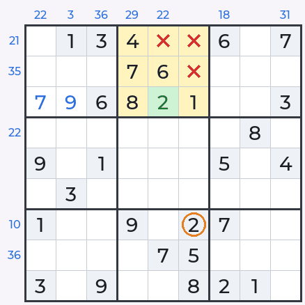

<!-- Written by tools/walkthrough.py before-nine: edit the script, not this page. -->
# Before Nine, step 3: the 2 in box 2

**Step 3 of 53** · [← Step 2](step-02.md) · [All steps](../before-nine.md#the-whole-puzzle-step-by-step) · [Step 4 →](step-04.md)

Box 2 needs a 2. r1c6 and r2c6: column 6 has one (r7c6). r1c5: from the left of row 1, a 2 there leaves no way for the digits before the 9 to add up to its clue 21. Only **r3c5** is left: **r3c5 = 2**.

**Step 3 of 53** · [← Step 2](step-02.md) · [All steps](../before-nine.md#the-whole-puzzle-step-by-step) · [Step 4 →](step-04.md)
