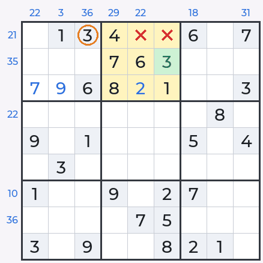

<!-- Written by tools/walkthrough.py before-nine: edit the script, not this page. -->
# Before Nine, step 4: the 3 in box 2

**Step 4 of 53** · [← Step 3](step-03.md) · [All steps](../before-nine.md#the-whole-puzzle-step-by-step) · [Step 5 →](step-05.md)

Box 2 needs a 3. r1c5 and r1c6: row 1 has one (r1c3). Only **r2c6** is left: **r2c6 = 3**.

**Step 4 of 53** · [← Step 3](step-03.md) · [All steps](../before-nine.md#the-whole-puzzle-step-by-step) · [Step 5 →](step-05.md)
