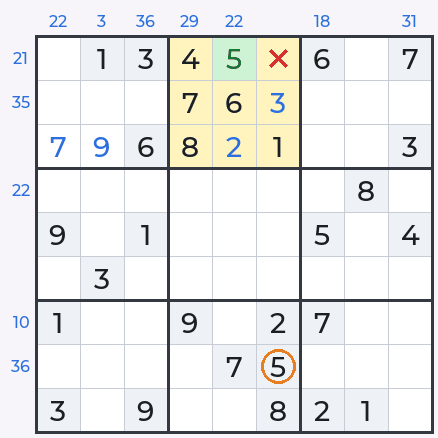

<!-- Written by tools/walkthrough.py before-nine: edit the script, not this page. -->
# Before Nine, step 5: the 5 in box 2

**Step 5 of 53** · [← Step 4](step-04.md) · [All steps](../before-nine.md#the-whole-puzzle-step-by-step) · [Step 6 →](step-06.md)

Box 2 needs a 5. r1c6: column 6 has one (r8c6). Only **r1c5** is left: **r1c5 = 5**.

**Step 5 of 53** · [← Step 4](step-04.md) · [All steps](../before-nine.md#the-whole-puzzle-step-by-step) · [Step 6 →](step-06.md)
