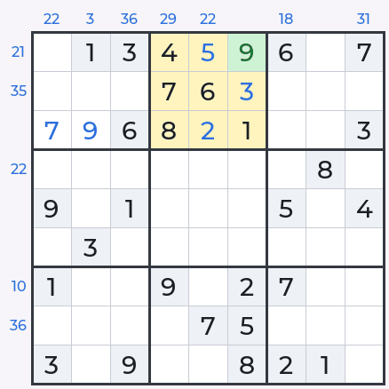

<!-- Written by tools/walkthrough.py before-nine: edit the script, not this page. -->
# Before Nine, step 6: the 9 in box 2

**Step 6 of 53** · [← Step 5](step-05.md) · [All steps](../before-nine.md#the-whole-puzzle-step-by-step) · [Step 7 →](step-07.md)

Box 2 needs a 9, and r1c6 is its last empty cell: **r1c6 = 9**.

**Step 6 of 53** · [← Step 5](step-05.md) · [All steps](../before-nine.md#the-whole-puzzle-step-by-step) · [Step 7 →](step-07.md)
