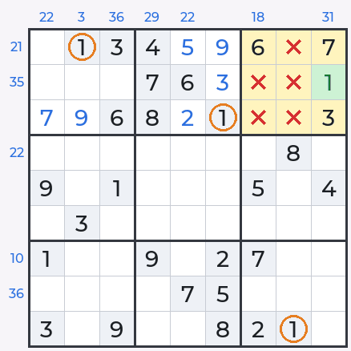

<!-- Written by tools/walkthrough.py before-nine: edit the script, not this page. -->
# Before Nine, step 7: the 1 in box 3

**Step 7 of 53** · [← Step 6](step-06.md) · [All steps](../before-nine.md#the-whole-puzzle-step-by-step) · [Step 8 →](step-08.md)

Box 3 needs a 1. r1c8: row 1 has one (r1c2). r2c8: column 8 has one (r9c8). r3c7 and r3c8: row 3 has one (r3c6). r2c7: from the left of row 2, a 1 there leaves no way for the digits before the 9 to add up to its clue 35. Only **r2c9** is left: **r2c9 = 1**.

**Step 7 of 53** · [← Step 6](step-06.md) · [All steps](../before-nine.md#the-whole-puzzle-step-by-step) · [Step 8 →](step-08.md)
