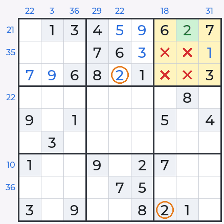

<!-- Written by tools/walkthrough.py before-nine: edit the script, not this page. -->
# Before Nine, step 8: the 2 in box 3

**Step 8 of 53** · [← Step 7](step-07.md) · [All steps](../before-nine.md#the-whole-puzzle-step-by-step) · [Step 9 →](step-09.md)

Box 3 needs a 2. r2c7: column 7 has one (r9c7). r3c7 and r3c8: row 3 has one (r3c5). r2c8: from the left of row 2, a 2 there leaves no way for the digits before the 9 to add up to its clue 35. Only **r1c8** is left: **r1c8 = 2**.

**Step 8 of 53** · [← Step 7](step-07.md) · [All steps](../before-nine.md#the-whole-puzzle-step-by-step) · [Step 9 →](step-09.md)
