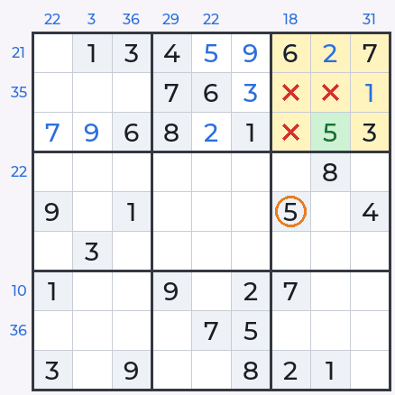

<!-- Written by tools/walkthrough.py before-nine: edit the script, not this page. -->
# Before Nine, step 9: the 5 in box 3

**Step 9 of 53** · [← Step 8](step-08.md) · [All steps](../before-nine.md#the-whole-puzzle-step-by-step) · [Step 10 →](step-10.md)

Box 3 needs a 5. r2c7 and r3c7: column 7 has one (r5c7). r2c8: from the left of row 2, a 5 there leaves no way for the digits before the 9 to add up to its clue 35. Only **r3c8** is left: **r3c8 = 5**.

**Step 9 of 53** · [← Step 8](step-08.md) · [All steps](../before-nine.md#the-whole-puzzle-step-by-step) · [Step 10 →](step-10.md)
