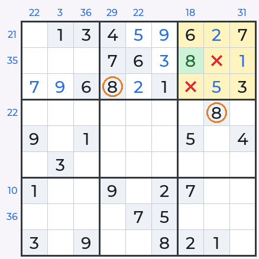

<!-- Written by tools/walkthrough.py before-nine: edit the script, not this page. -->
# Before Nine, step 10: the 8 in box 3

**Step 10 of 53** · [← Step 9](step-09.md) · [All steps](../before-nine.md#the-whole-puzzle-step-by-step) · [Step 11 →](step-11.md)

Box 3 needs an 8. r2c8: column 8 has one (r4c8). r3c7: row 3 has one (r3c4). Only **r2c7** is left: **r2c7 = 8**.

**Step 10 of 53** · [← Step 9](step-09.md) · [All steps](../before-nine.md#the-whole-puzzle-step-by-step) · [Step 11 →](step-11.md)
