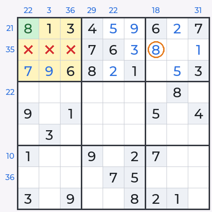

<!-- Written by tools/walkthrough.py before-nine: edit the script, not this page. -->
# Before Nine, step 11: the 8 in box 1

**Step 11 of 53** · [← Step 10](step-10.md) · [All steps](../before-nine.md#the-whole-puzzle-step-by-step) · [Step 12 →](step-12.md)

Box 1 needs an 8. r2c1, r2c2 and r2c3: row 2 has one (r2c7). Only **r1c1** is left: **r1c1 = 8**.

**Step 11 of 53** · [← Step 10](step-10.md) · [All steps](../before-nine.md#the-whole-puzzle-step-by-step) · [Step 12 →](step-12.md)
