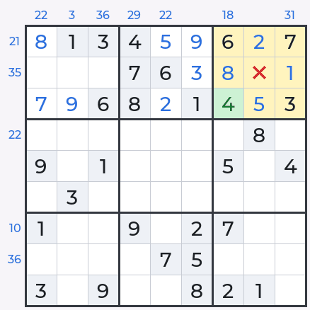

<!-- Written by tools/walkthrough.py before-nine: edit the script, not this page. -->
# Before Nine, step 12: the 4 in box 3

**Step 12 of 53** · [← Step 11](step-11.md) · [All steps](../before-nine.md#the-whole-puzzle-step-by-step) · [Step 13 →](step-13.md)

Box 3 needs a 4. r2c8: from the left of row 2, a 4 there leaves no way for the digits before the 9 to add up to its clue 35. Only **r3c7** is left: **r3c7 = 4**.

**Step 12 of 53** · [← Step 11](step-11.md) · [All steps](../before-nine.md#the-whole-puzzle-step-by-step) · [Step 13 →](step-13.md)
