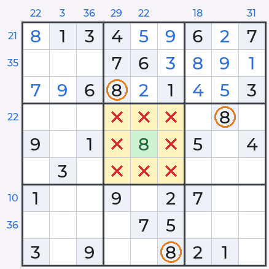

<!-- Written by tools/walkthrough.py before-nine: edit the script, not this page. -->
# Before Nine, step 14: the 8 in box 5

**Step 14 of 53** · [← Step 13](step-13.md) · [All steps](../before-nine.md#the-whole-puzzle-step-by-step) · [Step 15 →](step-15.md)

Box 5 needs an 8. r4c4, r4c5 and r4c6: row 4 has one (r4c8). r5c4 and r6c4: column 4 has one (r3c4). r5c6 and r6c6: column 6 has one (r9c6). r6c5: from the top of column 5, an 8 there leaves no way for the digits before the 9 to add up to its clue 22. Only **r5c5** is left: **r5c5 = 8**.

**Step 14 of 53** · [← Step 13](step-13.md) · [All steps](../before-nine.md#the-whole-puzzle-step-by-step) · [Step 15 →](step-15.md)
