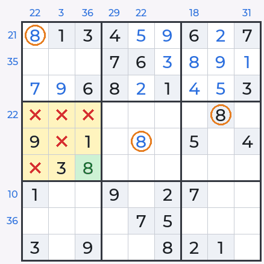

<!-- Written by tools/walkthrough.py before-nine: edit the script, not this page. -->
# Before Nine, step 15: the 8 in box 4

**Step 15 of 53** · [← Step 14](step-14.md) · [All steps](../before-nine.md#the-whole-puzzle-step-by-step) · [Step 16 →](step-16.md)

Box 4 needs an 8. r4c1, r4c2 and r4c3: row 4 has one (r4c8). r5c2: row 5 has one (r5c5). r6c1: column 1 has one (r1c1). Only **r6c3** is left: **r6c3 = 8**.

**Step 15 of 53** · [← Step 14](step-14.md) · [All steps](../before-nine.md#the-whole-puzzle-step-by-step) · [Step 16 →](step-16.md)
