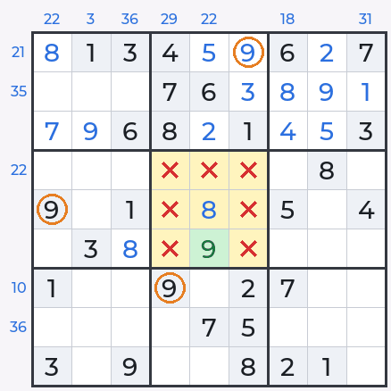

<!-- Written by tools/walkthrough.py before-nine: edit the script, not this page. -->
# Before Nine, step 16: the 9 in box 5

**Step 16 of 53** · [← Step 15](step-15.md) · [All steps](../before-nine.md#the-whole-puzzle-step-by-step) · [Step 17 →](step-17.md)

Box 5 needs a 9. r4c4 and r6c4: column 4 has one (r7c4). r4c6 and r6c6: column 6 has one (r1c6). r5c4 and r5c6: row 5 has one (r5c1). r4c5: from the top of column 5, the digits before the 9 would be 5, 6 and 2, adding up to 13, not its clue 22. Only **r6c5** is left: **r6c5 = 9**.

**Step 16 of 53** · [← Step 15](step-15.md) · [All steps](../before-nine.md#the-whole-puzzle-step-by-step) · [Step 17 →](step-17.md)
