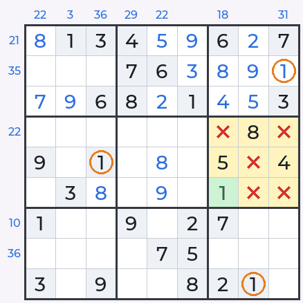

<!-- Written by tools/walkthrough.py before-nine: edit the script, not this page. -->
# Before Nine, step 17: the 1 in box 6

**Step 17 of 53** · [← Step 16](step-16.md) · [All steps](../before-nine.md#the-whole-puzzle-step-by-step) · [Step 18 →](step-18.md)

Box 6 needs a 1. r4c9 and r6c9: column 9 has one (r2c9). r5c8: row 5 has one (r5c3). r6c8: column 8 has one (r9c8). r4c7: from the top of column 7, 6, 8, 4, 1 and 5 would already add up to 24 before the 9, more than its clue 18. Only **r6c7** is left: **r6c7 = 1**.

**Step 17 of 53** · [← Step 16](step-16.md) · [All steps](../before-nine.md#the-whole-puzzle-step-by-step) · [Step 18 →](step-18.md)
