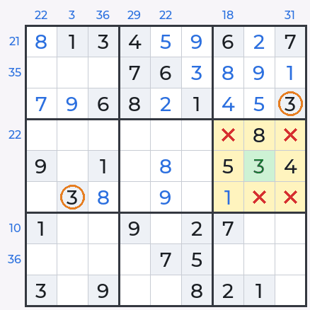

<!-- Written by tools/walkthrough.py before-nine: edit the script, not this page. -->
# Before Nine, step 18: the 3 in box 6

**Step 18 of 53** · [← Step 17](step-17.md) · [All steps](../before-nine.md#the-whole-puzzle-step-by-step) · [Step 19 →](step-19.md)

Box 6 needs a 3. r4c9: column 9 has one (r3c9). r6c8 and r6c9: row 6 has one (r6c2). r4c7: from the top of column 7, 6, 8, 4, 3, 5, 1 and 7 would already add up to 34 before the 9, more than its clue 18. Only **r5c8** is left: **r5c8 = 3**.

**Step 18 of 53** · [← Step 17](step-17.md) · [All steps](../before-nine.md#the-whole-puzzle-step-by-step) · [Step 19 →](step-19.md)
