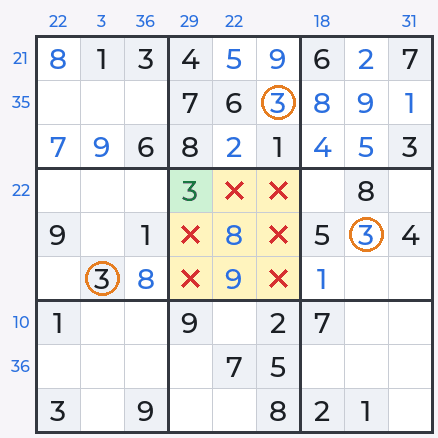

<!-- Written by tools/walkthrough.py before-nine: edit the script, not this page. -->
# Before Nine, step 19: the 3 in box 5

**Step 19 of 53** · [← Step 18](step-18.md) · [All steps](../before-nine.md#the-whole-puzzle-step-by-step) · [Step 20 →](step-20.md)

Box 5 needs a 3. r4c6: column 6 has one (r2c6). r5c4 and r5c6: row 5 has one (r5c8). r6c4 and r6c6: row 6 has one (r6c2). r4c5: from the top of column 5, the digits before the 9 would be 5, 6, 2, 3 and 8, adding up to 24, not its clue 22. Only **r4c4** is left: **r4c4 = 3**.

**Step 19 of 53** · [← Step 18](step-18.md) · [All steps](../before-nine.md#the-whole-puzzle-step-by-step) · [Step 20 →](step-20.md)
