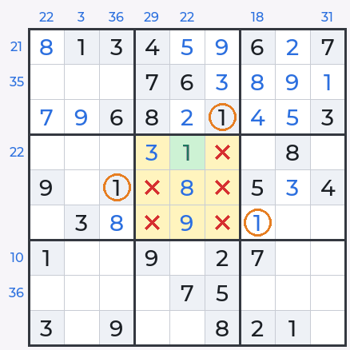

<!-- Written by tools/walkthrough.py before-nine: edit the script, not this page. -->
# Before Nine, step 20: the 1 in box 5

**Step 20 of 53** · [← Step 19](step-19.md) · [All steps](../before-nine.md#the-whole-puzzle-step-by-step) · [Step 21 →](step-21.md)

Box 5 needs a 1. r4c6: column 6 has one (r3c6). r5c4 and r5c6: row 5 has one (r5c3). r6c4 and r6c6: row 6 has one (r6c7). Only **r4c5** is left: **r4c5 = 1**.

**Step 20 of 53** · [← Step 19](step-19.md) · [All steps](../before-nine.md#the-whole-puzzle-step-by-step) · [Step 21 →](step-21.md)
