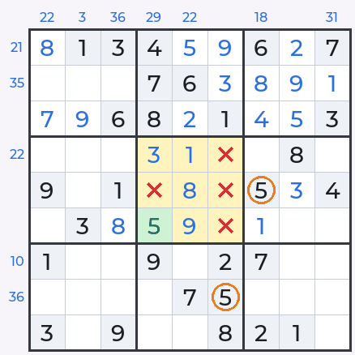

<!-- Written by tools/walkthrough.py before-nine: edit the script, not this page. -->
# Before Nine, step 21: the 5 in box 5

**Step 21 of 53** · [← Step 20](step-20.md) · [All steps](../before-nine.md#the-whole-puzzle-step-by-step) · [Step 22 →](step-22.md)

Box 5 needs a 5. r4c6 and r6c6: column 6 has one (r8c6). r5c4 and r5c6: row 5 has one (r5c7). Only **r6c4** is left: **r6c4 = 5**.

**Step 21 of 53** · [← Step 20](step-20.md) · [All steps](../before-nine.md#the-whole-puzzle-step-by-step) · [Step 22 →](step-22.md)
