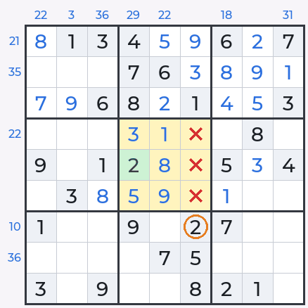

<!-- Written by tools/walkthrough.py before-nine: edit the script, not this page. -->
# Before Nine, step 22: the 2 in box 5

**Step 22 of 53** · [← Step 21](step-21.md) · [All steps](../before-nine.md#the-whole-puzzle-step-by-step) · [Step 23 →](step-23.md)

Box 5 needs a 2. r4c6, r5c6 and r6c6: column 6 has one (r7c6). Only **r5c4** is left: **r5c4 = 2**.

**Step 22 of 53** · [← Step 21](step-21.md) · [All steps](../before-nine.md#the-whole-puzzle-step-by-step) · [Step 23 →](step-23.md)
