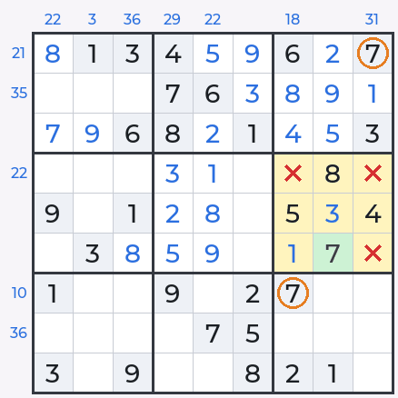

<!-- Written by tools/walkthrough.py before-nine: edit the script, not this page. -->
# Before Nine, step 23: the 7 in box 6

**Step 23 of 53** · [← Step 22](step-22.md) · [All steps](../before-nine.md#the-whole-puzzle-step-by-step) · [Step 24 →](step-24.md)

Box 6 needs a 7. r4c7: column 7 has one (r7c7). r4c9 and r6c9: column 9 has one (r1c9). Only **r6c8** is left: **r6c8 = 7**.

**Step 23 of 53** · [← Step 22](step-22.md) · [All steps](../before-nine.md#the-whole-puzzle-step-by-step) · [Step 24 →](step-24.md)
