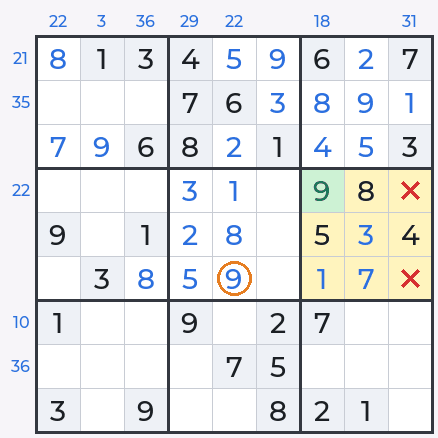

<!-- Written by tools/walkthrough.py before-nine: edit the script, not this page. -->
# Before Nine, step 24: the 9 in box 6

**Step 24 of 53** · [← Step 23](step-23.md) · [All steps](../before-nine.md#the-whole-puzzle-step-by-step) · [Step 25 →](step-25.md)

Box 6 needs a 9. r6c9: row 6 has one (r6c5). r4c9: from the left of row 4, a 9 there leaves no way for the digits before the 9 to add up to its clue 22. Only **r4c7** is left: **r4c7 = 9**.

**Step 24 of 53** · [← Step 23](step-23.md) · [All steps](../before-nine.md#the-whole-puzzle-step-by-step) · [Step 25 →](step-25.md)
