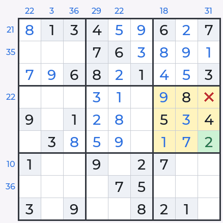

<!-- Written by tools/walkthrough.py before-nine: edit the script, not this page. -->
# Before Nine, step 25: the 2 in box 6

**Step 25 of 53** · [← Step 24](step-24.md) · [All steps](../before-nine.md#the-whole-puzzle-step-by-step) · [Step 26 →](step-26.md)

Box 6 needs a 2. r4c9: from the left of row 4, a 2 there leaves no way for the digits before the 9 to add up to its clue 22. Only **r6c9** is left: **r6c9 = 2**.

**Step 25 of 53** · [← Step 24](step-24.md) · [All steps](../before-nine.md#the-whole-puzzle-step-by-step) · [Step 26 →](step-26.md)
