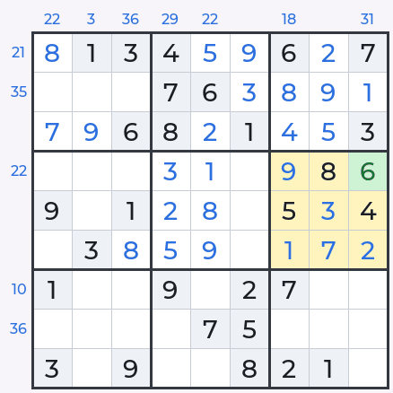

<!-- Written by tools/walkthrough.py before-nine: edit the script, not this page. -->
# Before Nine, step 26: the 6 in box 6

**Step 26 of 53** · [← Step 25](step-25.md) · [All steps](../before-nine.md#the-whole-puzzle-step-by-step) · [Step 27 →](step-27.md)

Box 6 needs a 6, and r4c9 is its last empty cell: **r4c9 = 6**.

**Step 26 of 53** · [← Step 25](step-25.md) · [All steps](../before-nine.md#the-whole-puzzle-step-by-step) · [Step 27 →](step-27.md)
