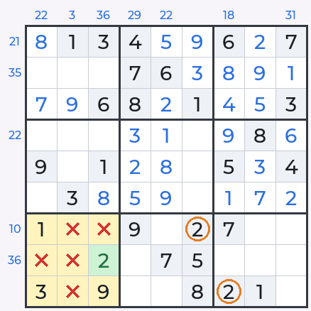

<!-- Written by tools/walkthrough.py before-nine: edit the script, not this page. -->
# Before Nine, step 27: the 2 in box 7

**Step 27 of 53** · [← Step 26](step-26.md) · [All steps](../before-nine.md#the-whole-puzzle-step-by-step) · [Step 28 →](step-28.md)

Box 7 needs a 2. r7c2 and r7c3: row 7 has one (r7c6). r9c2: row 9 has one (r9c7). r8c1: from the top of column 1, a 2 there leaves no way for the digits before the 9 to add up to its clue 22. r8c2: from the top of column 2, a 2 there leaves no way for the digits before the 9 to add up to its clue 3. Only **r8c3** is left: **r8c3 = 2**.

**Step 27 of 53** · [← Step 26](step-26.md) · [All steps](../before-nine.md#the-whole-puzzle-step-by-step) · [Step 28 →](step-28.md)
