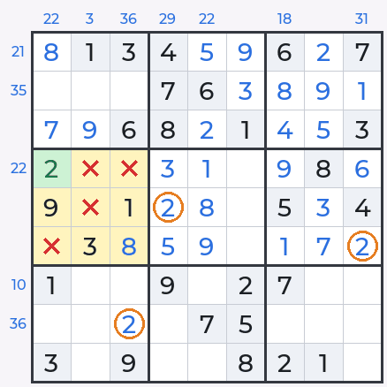

<!-- Written by tools/walkthrough.py before-nine: edit the script, not this page. -->
# Before Nine, step 28: the 2 in box 4

**Step 28 of 53** · [← Step 27](step-27.md) · [All steps](../before-nine.md#the-whole-puzzle-step-by-step) · [Step 29 →](step-29.md)

Box 4 needs a 2. r4c3: column 3 has one (r8c3). r5c2: row 5 has one (r5c4). r6c1: row 6 has one (r6c9). r4c2: from the top of column 2, a 2 there leaves no way for the digits before the 9 to add up to its clue 3. Only **r4c1** is left: **r4c1 = 2**.

**Step 28 of 53** · [← Step 27](step-27.md) · [All steps](../before-nine.md#the-whole-puzzle-step-by-step) · [Step 29 →](step-29.md)
