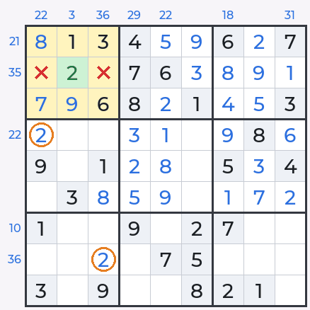

<!-- Written by tools/walkthrough.py before-nine: edit the script, not this page. -->
# Before Nine, step 29: the 2 in box 1

**Step 29 of 53** · [← Step 28](step-28.md) · [All steps](../before-nine.md#the-whole-puzzle-step-by-step) · [Step 30 →](step-30.md)

Box 1 needs a 2. r2c1: column 1 has one (r4c1). r2c3: column 3 has one (r8c3). Only **r2c2** is left: **r2c2 = 2**.

**Step 29 of 53** · [← Step 28](step-28.md) · [All steps](../before-nine.md#the-whole-puzzle-step-by-step) · [Step 30 →](step-30.md)
