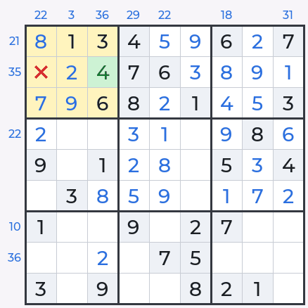

<!-- Written by tools/walkthrough.py before-nine: edit the script, not this page. -->
# Before Nine, step 30: the 4 in box 1

**Step 30 of 53** · [← Step 29](step-29.md) · [All steps](../before-nine.md#the-whole-puzzle-step-by-step) · [Step 31 →](step-31.md)

Box 1 needs a 4. r2c1: from the top of column 1, the digits before the 9 would be 8, 4, 7 and 2, adding up to 21, not its clue 22. Only **r2c3** is left: **r2c3 = 4**.

**Step 30 of 53** · [← Step 29](step-29.md) · [All steps](../before-nine.md#the-whole-puzzle-step-by-step) · [Step 31 →](step-31.md)
