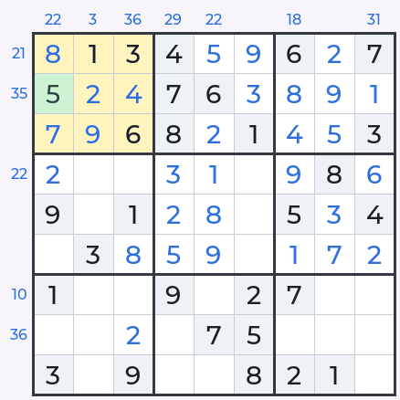

<!-- Written by tools/walkthrough.py before-nine: edit the script, not this page. -->
# Before Nine, step 31: the 5 in box 1

**Step 31 of 53** · [← Step 30](step-30.md) · [All steps](../before-nine.md#the-whole-puzzle-step-by-step) · [Step 32 →](step-32.md)

Box 1 needs a 5, and r2c1 is its last empty cell: **r2c1 = 5**.

**Step 31 of 53** · [← Step 30](step-30.md) · [All steps](../before-nine.md#the-whole-puzzle-step-by-step) · [Step 32 →](step-32.md)
