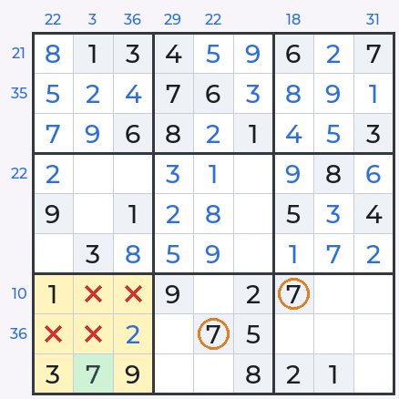

<!-- Written by tools/walkthrough.py before-nine: edit the script, not this page. -->
# Before Nine, step 32: the 7 in box 7

**Step 32 of 53** · [← Step 31](step-31.md) · [All steps](../before-nine.md#the-whole-puzzle-step-by-step) · [Step 33 →](step-33.md)

Box 7 needs a 7. r7c2 and r7c3: row 7 has one (r7c7). r8c1 and r8c2: row 8 has one (r8c5). Only **r9c2** is left: **r9c2 = 7**.

**Step 32 of 53** · [← Step 31](step-31.md) · [All steps](../before-nine.md#the-whole-puzzle-step-by-step) · [Step 33 →](step-33.md)
