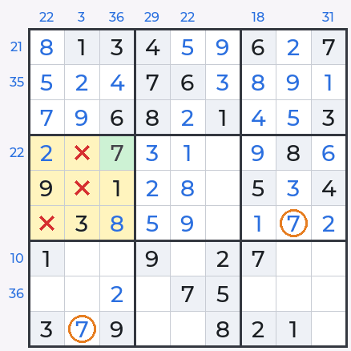

<!-- Written by tools/walkthrough.py before-nine: edit the script, not this page. -->
# Before Nine, step 33: the 7 in box 4

**Step 33 of 53** · [← Step 32](step-32.md) · [All steps](../before-nine.md#the-whole-puzzle-step-by-step) · [Step 34 →](step-34.md)

Box 4 needs a 7. r4c2 and r5c2: column 2 has one (r9c2). r6c1: row 6 has one (r6c8). Only **r4c3** is left: **r4c3 = 7**.

**Step 33 of 53** · [← Step 32](step-32.md) · [All steps](../before-nine.md#the-whole-puzzle-step-by-step) · [Step 34 →](step-34.md)
