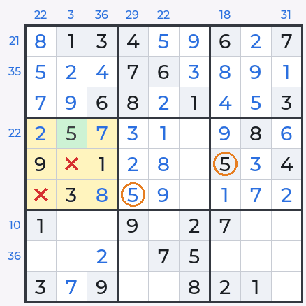

<!-- Written by tools/walkthrough.py before-nine: edit the script, not this page. -->
# Before Nine, step 34: the 5 in box 4

**Step 34 of 53** · [← Step 33](step-33.md) · [All steps](../before-nine.md#the-whole-puzzle-step-by-step) · [Step 35 →](step-35.md)

Box 4 needs a 5. r5c2: row 5 has one (r5c7). r6c1: row 6 has one (r6c4). Only **r4c2** is left: **r4c2 = 5**.

**Step 34 of 53** · [← Step 33](step-33.md) · [All steps](../before-nine.md#the-whole-puzzle-step-by-step) · [Step 35 →](step-35.md)
