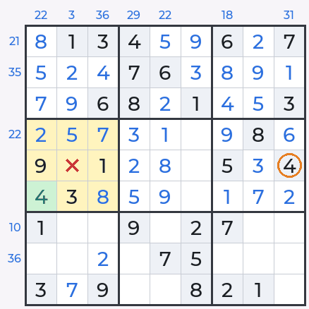

<!-- Written by tools/walkthrough.py before-nine: edit the script, not this page. -->
# Before Nine, step 35: the 4 in box 4

**Step 35 of 53** · [← Step 34](step-34.md) · [All steps](../before-nine.md#the-whole-puzzle-step-by-step) · [Step 36 →](step-36.md)

Box 4 needs a 4. r5c2: row 5 has one (r5c9). Only **r6c1** is left: **r6c1 = 4**.

**Step 35 of 53** · [← Step 34](step-34.md) · [All steps](../before-nine.md#the-whole-puzzle-step-by-step) · [Step 36 →](step-36.md)
