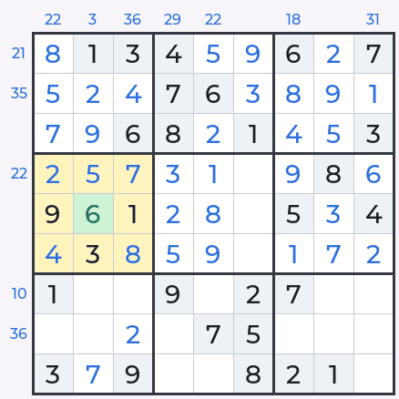

<!-- Written by tools/walkthrough.py before-nine: edit the script, not this page. -->
# Before Nine, step 36: the 6 in box 4

**Step 36 of 53** · [← Step 35](step-35.md) · [All steps](../before-nine.md#the-whole-puzzle-step-by-step) · [Step 37 →](step-37.md)

Box 4 needs a 6, and r5c2 is its last empty cell: **r5c2 = 6**.

**Step 36 of 53** · [← Step 35](step-35.md) · [All steps](../before-nine.md#the-whole-puzzle-step-by-step) · [Step 37 →](step-37.md)
