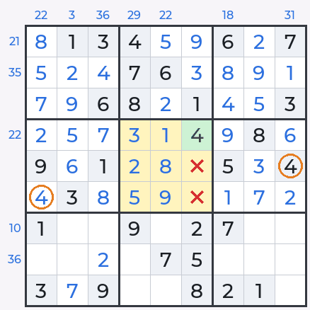

<!-- Written by tools/walkthrough.py before-nine: edit the script, not this page. -->
# Before Nine, step 37: the 4 in box 5

**Step 37 of 53** · [← Step 36](step-36.md) · [All steps](../before-nine.md#the-whole-puzzle-step-by-step) · [Step 38 →](step-38.md)

Box 5 needs a 4. r5c6: row 5 has one (r5c9). r6c6: row 6 has one (r6c1). Only **r4c6** is left: **r4c6 = 4**.

**Step 37 of 53** · [← Step 36](step-36.md) · [All steps](../before-nine.md#the-whole-puzzle-step-by-step) · [Step 38 →](step-38.md)
