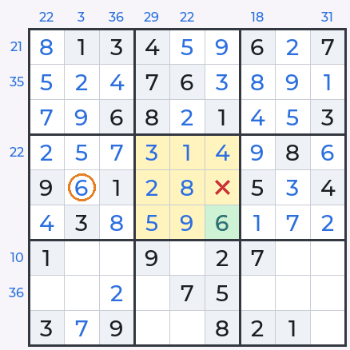

<!-- Written by tools/walkthrough.py before-nine: edit the script, not this page. -->
# Before Nine, step 38: the 6 in box 5

**Step 38 of 53** · [← Step 37](step-37.md) · [All steps](../before-nine.md#the-whole-puzzle-step-by-step) · [Step 39 →](step-39.md)

Box 5 needs a 6. r5c6: row 5 has one (r5c2). Only **r6c6** is left: **r6c6 = 6**.

**Step 38 of 53** · [← Step 37](step-37.md) · [All steps](../before-nine.md#the-whole-puzzle-step-by-step) · [Step 39 →](step-39.md)
