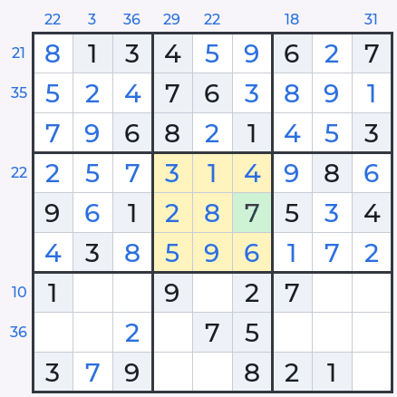

<!-- Written by tools/walkthrough.py before-nine: edit the script, not this page. -->
# Before Nine, step 39: the 7 in box 5

**Step 39 of 53** · [← Step 38](step-38.md) · [All steps](../before-nine.md#the-whole-puzzle-step-by-step) · [Step 40 →](step-40.md)

Box 5 needs a 7, and r5c6 is its last empty cell: **r5c6 = 7**.

**Step 39 of 53** · [← Step 38](step-38.md) · [All steps](../before-nine.md#the-whole-puzzle-step-by-step) · [Step 40 →](step-40.md)
