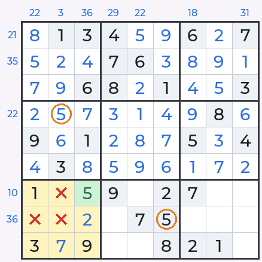

<!-- Written by tools/walkthrough.py before-nine: edit the script, not this page. -->
# Before Nine, step 40: the 5 in box 7

**Step 40 of 53** · [← Step 39](step-39.md) · [All steps](../before-nine.md#the-whole-puzzle-step-by-step) · [Step 41 →](step-41.md)

Box 7 needs a 5. r7c2: column 2 has one (r4c2). r8c1 and r8c2: row 8 has one (r8c6). Only **r7c3** is left: **r7c3 = 5**.

**Step 40 of 53** · [← Step 39](step-39.md) · [All steps](../before-nine.md#the-whole-puzzle-step-by-step) · [Step 41 →](step-41.md)
