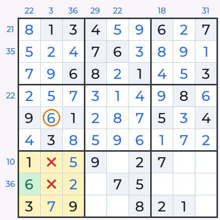

<!-- Written by tools/walkthrough.py before-nine: edit the script, not this page. -->
# Before Nine, step 41: the 6 in box 7

**Step 41 of 53** · [← Step 40](step-40.md) · [All steps](../before-nine.md#the-whole-puzzle-step-by-step) · [Step 42 →](step-42.md)

Box 7 needs a 6. r7c2 and r8c2: column 2 has one (r5c2). Only **r8c1** is left: **r8c1 = 6**.

**Step 41 of 53** · [← Step 40](step-40.md) · [All steps](../before-nine.md#the-whole-puzzle-step-by-step) · [Step 42 →](step-42.md)
