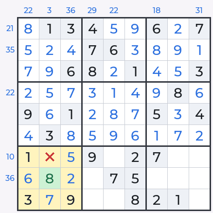

<!-- Written by tools/walkthrough.py before-nine: edit the script, not this page. -->
# Before Nine, step 42: the 8 in box 7

**Step 42 of 53** · [← Step 41](step-41.md) · [All steps](../before-nine.md#the-whole-puzzle-step-by-step) · [Step 43 →](step-43.md)

Box 7 needs an 8. r7c2: from the left of row 7, the digits before the 9 would be 1, 8 and 5, adding up to 14, not its clue 10. Only **r8c2** is left: **r8c2 = 8**.

**Step 42 of 53** · [← Step 41](step-41.md) · [All steps](../before-nine.md#the-whole-puzzle-step-by-step) · [Step 43 →](step-43.md)
