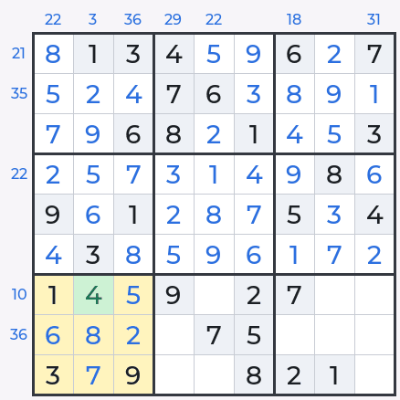

<!-- Written by tools/walkthrough.py before-nine: edit the script, not this page. -->
# Before Nine, step 43: the 4 in box 7

**Step 43 of 53** · [← Step 42](step-42.md) · [All steps](../before-nine.md#the-whole-puzzle-step-by-step) · [Step 44 →](step-44.md)

Box 7 needs a 4, and r7c2 is its last empty cell: **r7c2 = 4**.

**Step 43 of 53** · [← Step 42](step-42.md) · [All steps](../before-nine.md#the-whole-puzzle-step-by-step) · [Step 44 →](step-44.md)
