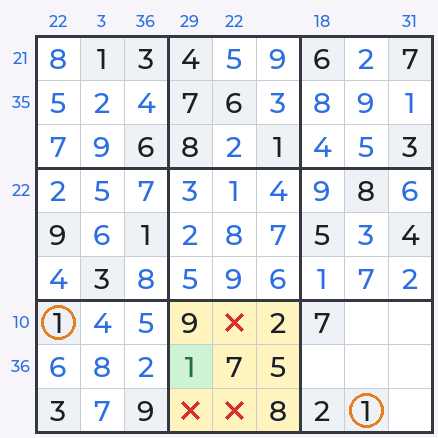

<!-- Written by tools/walkthrough.py before-nine: edit the script, not this page. -->
# Before Nine, step 44: the 1 in box 8

**Step 44 of 53** · [← Step 43](step-43.md) · [All steps](../before-nine.md#the-whole-puzzle-step-by-step) · [Step 45 →](step-45.md)

Box 8 needs a 1. r7c5: row 7 has one (r7c1). r9c4 and r9c5: row 9 has one (r9c8). Only **r8c4** is left: **r8c4 = 1**.

**Step 44 of 53** · [← Step 43](step-43.md) · [All steps](../before-nine.md#the-whole-puzzle-step-by-step) · [Step 45 →](step-45.md)
