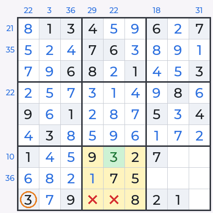

<!-- Written by tools/walkthrough.py before-nine: edit the script, not this page. -->
# Before Nine, step 45: the 3 in box 8

**Step 45 of 53** · [← Step 44](step-44.md) · [All steps](../before-nine.md#the-whole-puzzle-step-by-step) · [Step 46 →](step-46.md)

Box 8 needs a 3. r9c4 and r9c5: row 9 has one (r9c1). Only **r7c5** is left: **r7c5 = 3**.

**Step 45 of 53** · [← Step 44](step-44.md) · [All steps](../before-nine.md#the-whole-puzzle-step-by-step) · [Step 46 →](step-46.md)
