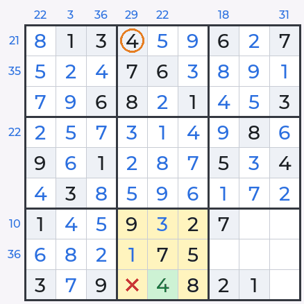

<!-- Written by tools/walkthrough.py before-nine: edit the script, not this page. -->
# Before Nine, step 46: the 4 in box 8

**Step 46 of 53** · [← Step 45](step-45.md) · [All steps](../before-nine.md#the-whole-puzzle-step-by-step) · [Step 47 →](step-47.md)

Box 8 needs a 4. r9c4: column 4 has one (r1c4). Only **r9c5** is left: **r9c5 = 4**.

**Step 46 of 53** · [← Step 45](step-45.md) · [All steps](../before-nine.md#the-whole-puzzle-step-by-step) · [Step 47 →](step-47.md)
