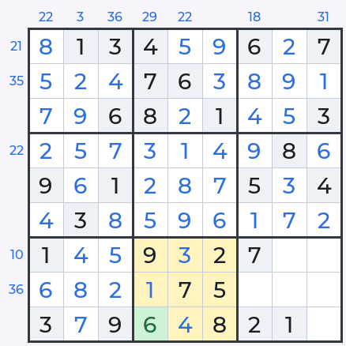

<!-- Written by tools/walkthrough.py before-nine: edit the script, not this page. -->
# Before Nine, step 47: the 6 in box 8

**Step 47 of 53** · [← Step 46](step-46.md) · [All steps](../before-nine.md#the-whole-puzzle-step-by-step) · [Step 48 →](step-48.md)

Box 8 needs a 6, and r9c4 is its last empty cell: **r9c4 = 6**.

**Step 47 of 53** · [← Step 46](step-46.md) · [All steps](../before-nine.md#the-whole-puzzle-step-by-step) · [Step 48 →](step-48.md)
