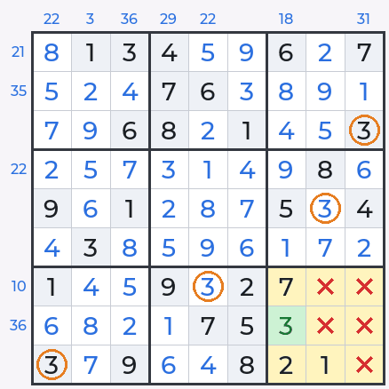

<!-- Written by tools/walkthrough.py before-nine: edit the script, not this page. -->
# Before Nine, step 48: the 3 in box 9

**Step 48 of 53** · [← Step 47](step-47.md) · [All steps](../before-nine.md#the-whole-puzzle-step-by-step) · [Step 49 →](step-49.md)

Box 9 needs a 3. r7c8 and r7c9: row 7 has one (r7c5). r8c8: column 8 has one (r5c8). r8c9: column 9 has one (r3c9). r9c9: row 9 has one (r9c1). Only **r8c7** is left: **r8c7 = 3**.

**Step 48 of 53** · [← Step 47](step-47.md) · [All steps](../before-nine.md#the-whole-puzzle-step-by-step) · [Step 49 →](step-49.md)
