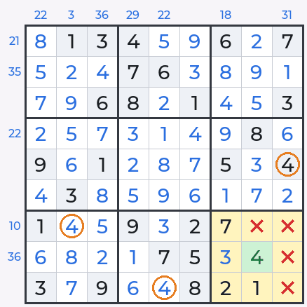

<!-- Written by tools/walkthrough.py before-nine: edit the script, not this page. -->
# Before Nine, step 49: the 4 in box 9

**Step 49 of 53** · [← Step 48](step-48.md) · [All steps](../before-nine.md#the-whole-puzzle-step-by-step) · [Step 50 →](step-50.md)

Box 9 needs a 4. r7c8 and r7c9: row 7 has one (r7c2). r8c9: column 9 has one (r5c9). r9c9: row 9 has one (r9c5). Only **r8c8** is left: **r8c8 = 4**.

**Step 49 of 53** · [← Step 48](step-48.md) · [All steps](../before-nine.md#the-whole-puzzle-step-by-step) · [Step 50 →](step-50.md)
