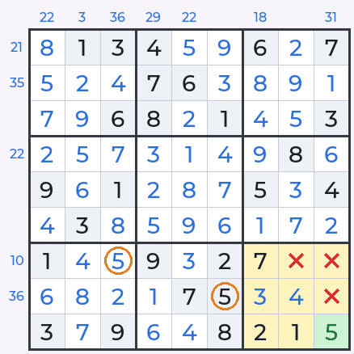

<!-- Written by tools/walkthrough.py before-nine: edit the script, not this page. -->
# Before Nine, step 50: the 5 in box 9

**Step 50 of 53** · [← Step 49](step-49.md) · [All steps](../before-nine.md#the-whole-puzzle-step-by-step) · [Step 51 →](step-51.md)

Box 9 needs a 5. r7c8 and r7c9: row 7 has one (r7c3). r8c9: row 8 has one (r8c6). Only **r9c9** is left: **r9c9 = 5**.

**Step 50 of 53** · [← Step 49](step-49.md) · [All steps](../before-nine.md#the-whole-puzzle-step-by-step) · [Step 51 →](step-51.md)
