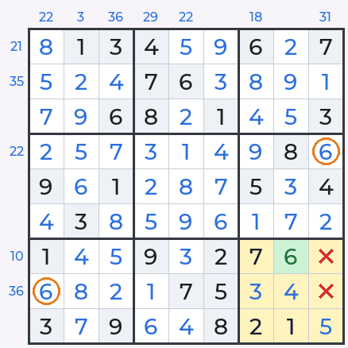

<!-- Written by tools/walkthrough.py before-nine: edit the script, not this page. -->
# Before Nine, step 51: the 6 in box 9

**Step 51 of 53** · [← Step 50](step-50.md) · [All steps](../before-nine.md#the-whole-puzzle-step-by-step) · [Step 52 →](step-52.md)

Box 9 needs a 6. r7c9: column 9 has one (r4c9). r8c9: row 8 has one (r8c1). Only **r7c8** is left: **r7c8 = 6**.

**Step 51 of 53** · [← Step 50](step-50.md) · [All steps](../before-nine.md#the-whole-puzzle-step-by-step) · [Step 52 →](step-52.md)
