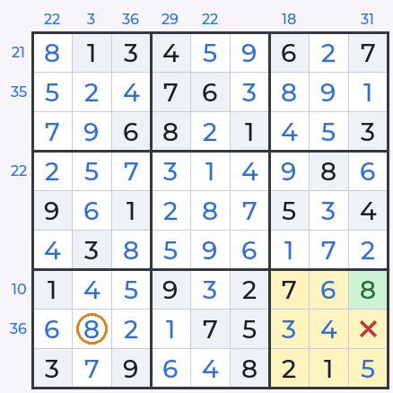

<!-- Written by tools/walkthrough.py before-nine: edit the script, not this page. -->
# Before Nine, step 52: the 8 in box 9

**Step 52 of 53** · [← Step 51](step-51.md) · [All steps](../before-nine.md#the-whole-puzzle-step-by-step) · [Step 53 →](step-53.md)

Box 9 needs an 8. r8c9: row 8 has one (r8c2). Only **r7c9** is left: **r7c9 = 8**.

**Step 52 of 53** · [← Step 51](step-51.md) · [All steps](../before-nine.md#the-whole-puzzle-step-by-step) · [Step 53 →](step-53.md)
