# Between Lines

[← All variants](README.md) · [Puzzles](../features-puzzles.md) · [How to play](../how-to-play.md)

## The rules

[Classic](classic.md) rules, plus **grey lines with a circle at each end**, through cells side by side or diagonal. Every digit on a line, between its two circles, lies **strictly between the two circled digits**: with 3 and 8 in the circles, the cells between hold 4 to 7. Either circle can be the smaller one, and the cells between may repeat a digit where the rows, columns and boxes allow it.

## On the board

- Each line is a grey line from one ring to the other.
- With both circles filled, a digit on the line that isn't strictly between them turns red, with the circles.
- The grader and hints keep, for each cell, the digits some pair of circles allows, and for each circle the digits that leave every cell between something to hold: "The digits on this line lie between the digits in its two circles, so row 6, column 3 can only be 9".
- **Puzzles → ⋮ → New puzzle → Lines → Between**: 8 lines (Hard and Expert 10) of 3 to 7 cells.

## How to solve it

- **The circles are far apart:** a line with a 7 between its circles has one circle at 6 or less and the other at 8 or more.
- **Long lines need wide gaps:** the cells between are often different digits (in a row or box), so the gap must fit them: four different digits between need circles at least 5 apart.
- **A circle at 1 or 9 settles the side:** the other circle is the high (or low) end.
- **No 1 or 9 between:** nothing is strictly below 1 or above 9.

## Worked example

**variant-examples #31**, Between Lines Easy (see [Classic](classic.md#worked-example-the-whole-puzzle) for how to import the examples; cells are written r*row*c*column*). The lines are in the screenshot; three matter here:

- a line of **four**: circles at r9c2 (a 5) and r6c3, with r8c3 (a 6) and r7c3 (a 7) between;
- a line of **three**: circles at r9c1 (a 4) and r7c1, with r8c1 (an 8) between;
- another line of **three**: circles at r2c7 (a 7) and r2c5, with r3c6 between.

**Step 1: r6c3, a circle of the line of four.** Row 6 has a 4; column 3 has 1, 2, 3, 6 and 7; box 4 has an 8; that leaves 5 and 9. The 6 and 7 between must be strictly between the 5 in the other circle and this one, so this one is 8 or more. **r6c3 = 9**.

**Step 2: r7c1, a circle of the first line of three.** Row 7 has 6 and 7; column 1 has 1, 4 and 8; box 7 has 3 and 5; that leaves 2 and 9. The 8 between needs this circle above it, since the other one is a 4. **r7c1 = 9**.

**Step 3: the 1 in row 3.** Row 3 has 5 and 7. The 1s in r1c1 (box 1), r9c3, r5c5 and r2c9 (box 3) rule it out of r3c2, r3c3, r3c5, r3c8 and r3c9. That leaves r3c4 and r3c6. r3c6 is between the circles of the second line of three, one of them a 7: a 1 there would need the other circle below 1. **r3c4 = 1**.

## The whole puzzle, step by step

<!-- walkthrough -->
<!-- Written by tools/walkthrough.py between-lines: edit the script, not this part. -->

The whole puzzle, from the start to the last cell: 50 steps, each one a single (one place left for a digit, or one digit left for a cell), taken in the order a box's single comes first, so not quite the order of the worked example above. In each picture, the unit the step looks at is tinted yellow (for a cell with one digit left: its row, column and box), the new digit is on green, the digits that rule cells out have an **orange ring**, and the empty cells they rule out a **red cross**. Givens are on grey, digits from earlier steps in blue.

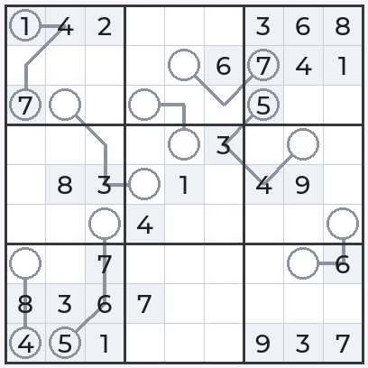

#### Step 1: the 3 in box 1

Box 1 needs a 3. r2c2 and r3c2: column 2 has one (r8c2). r2c3 and r3c3: column 3 has one (r5c3). Only **r2c1** is left: **r2c1 = 3**.

#### Step 2: the 5 in box 1

Box 1 needs a 5. r2c2: column 2 has one (r9c2). r3c2 and r3c3: row 3 has one (r3c7). Only **r2c3** is left: **r2c3 = 5**.

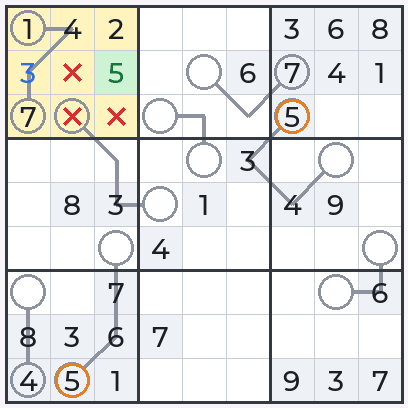

#### Step 3: the 6 in box 1

Box 1 needs a 6. r2c2: row 2 has one (r2c6). r3c3: column 3 has one (r8c3). Only **r3c2** is left: **r3c2 = 6**.

#### Step 4: the 8 in box 1

Box 1 needs an 8. r2c2: column 2 has one (r5c2). Only **r3c3** is left: **r3c3 = 8**.

#### Step 5: the 9 in box 1

Box 1 needs a 9, and r2c2 is its last empty cell: **r2c2 = 9**.

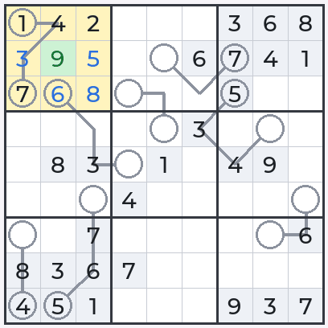

#### Step 6: the 1 in box 2

Box 2 needs a 1. r1c4, r1c5 and r1c6: row 1 has one (r1c1). r2c4 and r2c5: row 2 has one (r2c9). r3c5: column 5 has one (r5c5). r3c6: it's on a line from the circle 7 in r2c7: a 1 couldn't be strictly between that and the other circle. Only **r3c4** is left: **r3c4 = 1**.

#### Step 7: the 3 in box 2

Box 2 needs a 3. r1c4, r1c5 and r1c6: row 1 has one (r1c7). r2c4 and r2c5: row 2 has one (r2c1). r3c6: column 6 has one (r4c6). Only **r3c5** is left: **r3c5 = 3**.

#### Step 8: the 4 in box 2

Box 2 needs a 4. r1c4, r1c5 and r1c6: row 1 has one (r1c2). r2c4 and r2c5: row 2 has one (r2c8). Only **r3c6** is left: **r3c6 = 4**.

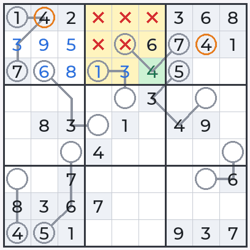

#### Step 9: the 8 in box 2

Box 2 needs an 8. r1c4, r1c5 and r1c6: row 1 has one (r1c9). r2c5: it's a circle, and its line already has 4 between it and the 7 in r2c7: an 8 there wouldn't leave them strictly between. Only **r2c4** is left: **r2c4 = 8**.

#### Step 10: the 2 in box 2

Box 2 needs a 2. r1c4, r1c5 and r1c6: row 1 has one (r1c3). Only **r2c5** is left: **r2c5 = 2**.

#### Step 11: the 9 in box 3

Box 3 needs a 9. r3c8: column 8 has one (r5c8). Only **r3c9** is left: **r3c9 = 9**.

#### Step 12: the 2 in box 3

Box 3 needs a 2, and r3c8 is its last empty cell: **r3c8 = 2**.

#### Step 13: the 4 in box 4

Box 4 needs a 4. r4c1: column 1 has one (r9c1). r4c2: column 2 has one (r1c2). r5c1: row 5 has one (r5c7). r6c1, r6c2 and r6c3: row 6 has one (r6c4). Only **r4c3** is left: **r4c3 = 4**.

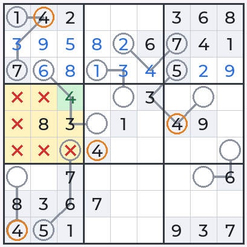

#### Step 14: the 3 in box 6

Box 6 needs a 3. r4c7, r4c8 and r4c9: row 4 has one (r4c6). r5c9: row 5 has one (r5c3). r6c7: column 7 has one (r1c7). r6c8: column 8 has one (r9c8). Only **r6c9** is left: **r6c9 = 3**.

#### Step 15: the 7 in box 6

Box 6 needs a 7. r4c7 and r6c7: column 7 has one (r2c7). r4c9 and r5c9: column 9 has one (r9c9). r4c8: it's a circle, and its line already has 3 and 4 between it and the 5 in r3c7: a 7 there wouldn't leave them strictly between. Only **r6c8** is left: **r6c8 = 7**.

#### Step 16: the 7 in box 4

Box 4 needs a 7. r4c1 and r5c1: column 1 has one (r3c1). r6c1, r6c2 and r6c3: row 6 has one (r6c8). Only **r4c2** is left: **r4c2 = 7**.

#### Step 17: the 1 in box 4

Box 4 needs a 1. r4c1 and r6c1: column 1 has one (r1c1). r5c1: row 5 has one (r5c5). r6c3: column 3 has one (r9c3). Only **r6c2** is left: **r6c2 = 1**.

#### Step 18: the 7 in box 5

Box 5 needs a 7. r4c4 and r4c5: row 4 has one (r4c2). r5c4: column 4 has one (r8c4). r6c5 and r6c6: row 6 has one (r6c8). Only **r5c6** is left: **r5c6 = 7**.

#### Step 19: the 7 in box 2

Box 2 needs a 7. r1c4: column 4 has one (r8c4). r1c6: column 6 has one (r5c6). Only **r1c5** is left: **r1c5 = 7**.

#### Step 20: the 2 in box 7

Box 7 needs a 2. r7c1: it's a circle, and its line already has 8 between it and the 4 in r9c1: a 2 there wouldn't leave them strictly between. Only **r7c2** is left: **r7c2 = 2**.

#### Step 21: the 9 in box 7

Box 7 needs a 9, and r7c1 is its last empty cell: **r7c1 = 9**.

#### Step 22: the 9 in box 4

Box 4 needs a 9. r4c1 and r6c1: column 1 has one (r7c1). r5c1: row 5 has one (r5c8). Only **r6c3** is left: **r6c3 = 9**.

#### Step 23: the 3 in box 8

Box 8 needs a 3. r7c5: column 5 has one (r3c5). r7c6: column 6 has one (r4c6). r8c5 and r8c6: row 8 has one (r8c2). r9c4, r9c5 and r9c6: row 9 has one (r9c8). Only **r7c4** is left: **r7c4 = 3**.

#### Step 24: the 4 in box 9

Box 9 needs a 4. r7c7 and r8c7: column 7 has one (r5c7). r7c8 and r8c8: column 8 has one (r2c8). Only **r8c9** is left: **r8c9 = 4**.

#### Step 25: the 4 in box 8

Box 8 needs a 4. r7c6: column 6 has one (r3c6). r8c5 and r8c6: row 8 has one (r8c9). r9c4, r9c5 and r9c6: row 9 has one (r9c1). Only **r7c5** is left: **r7c5 = 4**.

#### Step 26: the 2 in box 9

Box 9 needs a 2. r7c7 and r7c8: row 7 has one (r7c2). r8c8: column 8 has one (r3c8). Only **r8c7** is left: **r8c7 = 2**.

#### Step 27: the 5 in box 9

Box 9 needs a 5. r7c7: column 7 has one (r3c7). r7c8: it's a circle, and its line already has 6 between it and the 3 in r6c9: a 5 there wouldn't leave them strictly between. Only **r8c8** is left: **r8c8 = 5**.

#### Step 28: the 5 in box 8

Box 8 needs a 5. r8c5 and r8c6: row 8 has one (r8c8). r9c4, r9c5 and r9c6: row 9 has one (r9c2). Only **r7c6** is left: **r7c6 = 5**.

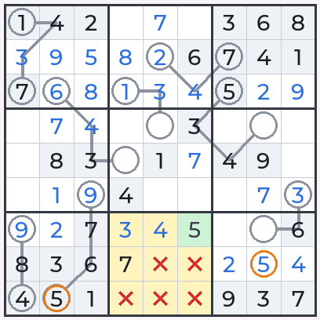

#### Step 29: the 5 in box 2

Box 2 needs a 5. r1c6: column 6 has one (r7c6). Only **r1c4** is left: **r1c4 = 5**.

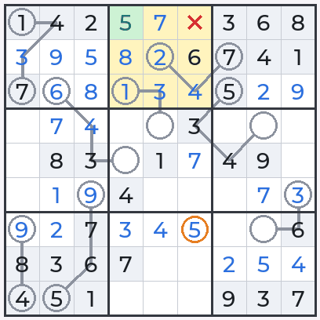

#### Step 30: the 9 in box 2

Box 2 needs a 9, and r1c6 is its last empty cell: **r1c6 = 9**.

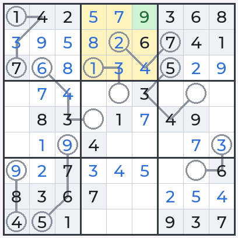

#### Step 31: the 1 in box 8

Box 8 needs a 1. r8c5: column 5 has one (r5c5). r9c4, r9c5 and r9c6: row 9 has one (r9c3). Only **r8c6** is left: **r8c6 = 1**.

#### Step 32: the 9 in box 8

Box 8 needs a 9. r9c4, r9c5 and r9c6: row 9 has one (r9c7). Only **r8c5** is left: **r8c5 = 9**.

#### Step 33: the 9 in box 5

Box 5 needs a 9. r4c5: column 5 has one (r8c5). r5c4: row 5 has one (r5c8). r6c5 and r6c6: row 6 has one (r6c3). Only **r4c4** is left: **r4c4 = 9**.

#### Step 34: the 1 in box 9

Box 9 needs a 1. r7c8: it's a circle, and its line already has 6 between it and the 3 in r6c9: a 1 there wouldn't leave them strictly between. Only **r7c7** is left: **r7c7 = 1**.

#### Step 35: the 1 in box 6

Box 6 needs a 1. r4c7: column 7 has one (r7c7). r4c9: column 9 has one (r2c9). r5c9: row 5 has one (r5c5). r6c7: row 6 has one (r6c2). Only **r4c8** is left: **r4c8 = 1**.

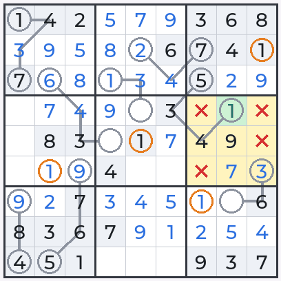

#### Step 36: the 8 in box 9

Box 9 needs an 8, and r7c8 is its last empty cell: **r7c8 = 8**.

#### Step 37: the 6 in row 5

Row 5 needs a 6. r5c9: column 9 has one (r7c9). r5c4: it's a circle, and its line already has 4 and 3 between it and the 6 in r3c2: a 6 there wouldn't leave them strictly between. Only **r5c1** is left: **r5c1 = 6**.

#### Step 38: the 5 in row 5

Row 5 needs a 5. r5c4: column 4 has one (r1c4). Only **r5c9** is left: **r5c9 = 5**.

#### Step 39: the 2 in box 6

Box 6 needs a 2. r4c7 and r6c7: column 7 has one (r8c7). Only **r4c9** is left: **r4c9 = 2**.

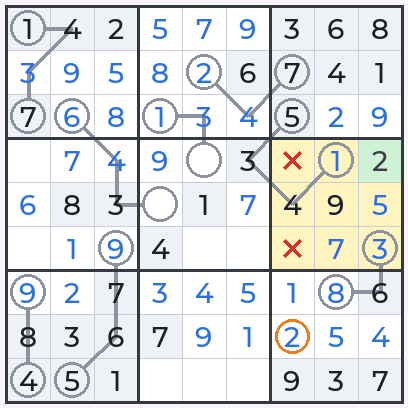

#### Step 40: the 2 in box 4

Box 4 needs a 2. r4c1: row 4 has one (r4c9). Only **r6c1** is left: **r6c1 = 2**.

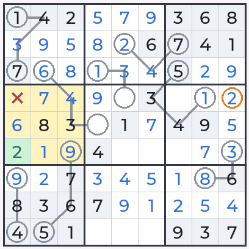

#### Step 41: the 5 in box 4

Box 4 needs a 5, and r4c1 is its last empty cell: **r4c1 = 5**.

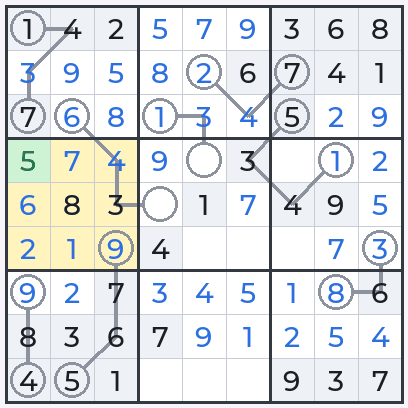

#### Step 42: the 2 in box 5

Box 5 needs a 2. r4c5: row 4 has one (r4c9). r6c5 and r6c6: row 6 has one (r6c1). Only **r5c4** is left: **r5c4 = 2**.

#### Step 43: the 5 in box 5

Box 5 needs a 5. r4c5: row 4 has one (r4c1). r6c6: column 6 has one (r7c6). Only **r6c5** is left: **r6c5 = 5**.

#### Step 44: the 6 in box 5

Box 5 needs a 6. r6c6: column 6 has one (r2c6). Only **r4c5** is left: **r4c5 = 6**.

#### Step 45: the 8 in box 5

Box 5 needs an 8, and r6c6 is its last empty cell: **r6c6 = 8**.

#### Step 46: the 6 in box 6

Box 6 needs a 6. r4c7: row 4 has one (r4c5). Only **r6c7** is left: **r6c7 = 6**.

#### Step 47: the 8 in box 6

Box 6 needs an 8, and r4c7 is its last empty cell: **r4c7 = 8**.

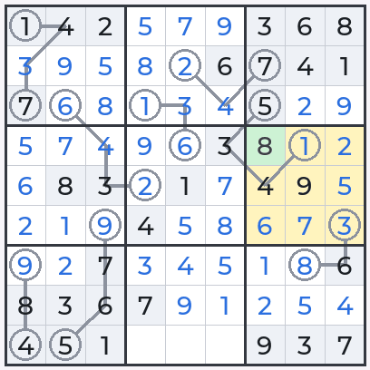

#### Step 48: the 2 in box 8

Box 8 needs a 2. r9c4: column 4 has one (r5c4). r9c5: column 5 has one (r2c5). Only **r9c6** is left: **r9c6 = 2**.

#### Step 49: the 6 in box 8

Box 8 needs a 6. r9c5: column 5 has one (r4c5). Only **r9c4** is left: **r9c4 = 6**.

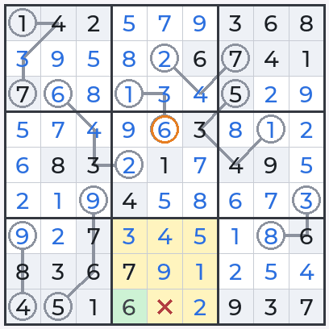

#### Step 50: the 8 in box 8

Box 8 needs an 8, and r9c5 is its last empty cell: **r9c5 = 8**.

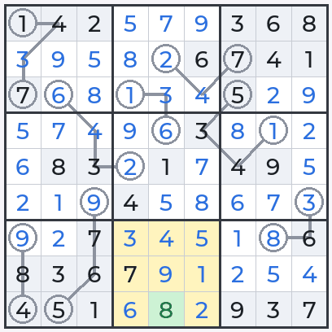

Solved.

<!-- /walkthrough -->
